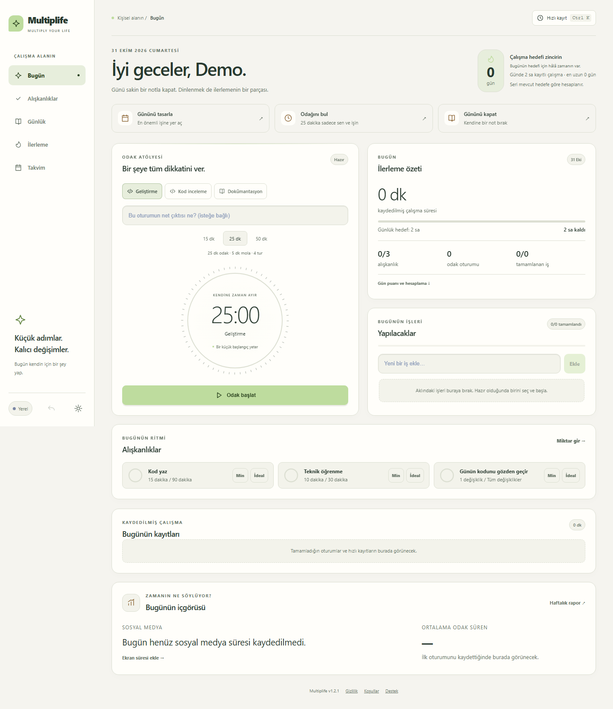
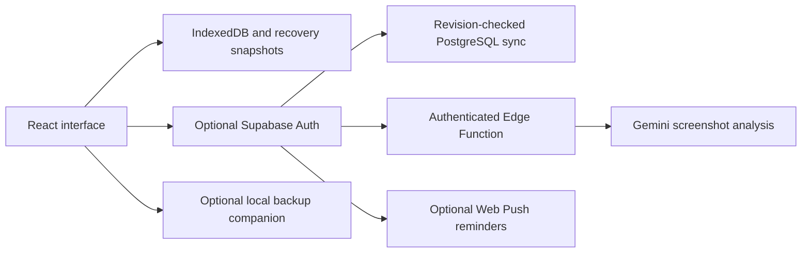

# Multiplife

**Multiply Your Life.**

A personal productivity PWA that brings focus sessions, tasks, habits, screen-time records and long-term goals into one workspace. Everyday records are saved locally; accounts, cloud sync and AI-assisted screen-time analysis are optional.

[Türkçe](README.tr.md) · [Hosted app](https://momentum-kappa-sepia.vercel.app) · [Architecture and decisions](docs/ARCHITECTURE.md) · [Verification](docs/VERIFICATION.md)



> Existing records and backups remain compatible after the name change. See [name-change compatibility](docs/ARCHITECTURE.md#name-change-compatibility) for the retained internal identifiers.

## Why I built it

I wanted one place to plan useful work and compare the plan with time actually recorded. A task list alone does not show where time went; a timer alone does not connect sessions to daily priorities. Multiplife connects those records while keeping the core workflow available without an account.

## What it does

| Workflow | Implemented behavior |
| --- | --- |
| Focus | Configurable work/break sessions, intention and closing notes, task-linked timers and saved session history. |
| Planning | Tasks with categories and completion filters, unfinished-task carryover, calendar blocks, `.ics` export and quick capture. |
| Habits and goals | Minimum/ideal habit targets, selected weekdays, temporary freezes, weekly reviews and milestone-based goals. |
| Reporting | Daily records, weekly/monthly views, topic totals and comparisons built from recorded sessions. |
| Screen time | Manual entries and optional Gemini analysis of a user-selected screen-time screenshot. |
| Data recovery | IndexedDB storage, recovery snapshots, validated JSON imports/exports and a local trash history. |
| Device sync | Optional Supabase accounts with explicit initial local/cloud selection and revision-checked writes. |
| Reminders | Optional Web Push subscriptions managed per account and device. Browser and OS support still apply. |
| Desktop backup | A local companion server can write verified backups to a Google Drive for desktop folder; supported browsers can also use a user-selected folder. |

## Technology

- **UI:** React 19, TypeScript, Vite, responsive CSS and accessible modal flows.
- **Local storage:** IndexedDB, versioned state, recovery snapshots and JSON backup validation.
- **Optional backend:** Supabase Auth, PostgreSQL with Row Level Security and Edge Functions.
- **Applied AI:** Gemini API behind an authenticated server function for screen-time screenshot interpretation.
- **Verification:** Node test runner, ESLint, TypeScript, Playwright and GitHub Actions.
- **Hosting:** The existing hosted application uses Vercel; cloud features use Supabase.

The AI feature integrates an existing model API. It does not train a model, and core productivity features do not require an AI provider.

## Architecture



The app stores records locally before optional cloud synchronization. On the first account connection, the user chooses which state to keep rather than silently merging unrelated records. Subsequent cloud writes carry a revision so an older device does not overwrite a newer state without a conflict being detected.

See [architecture and tradeoffs](docs/ARCHITECTURE.md) for storage, timing, AI and backup boundaries.

## Run locally

Use **Node.js 24.x**, matching `package.json`.

```bash
npm ci
npm run dev
```

Without cloud configuration, the application keeps its local workflow available and disables account features. To enable those features, copy `.env.example` to `.env.local` and add your own Supabase project URL and publishable key. Instructions for database migrations and Edge Functions are in [supabase/README.md](supabase/README.md).

Only browser-safe values belong in `VITE_` variables. Provider secrets and service-role keys belong in server-side configuration.

## Verify the source

```bash
npm run check
```

This runs unit/regression tests, lint, TypeScript, static asset checks and a production build.

```bash
npx playwright install chromium firefox webkit
npm run test:e2e
```

To test the built application and offline PWA behavior:

```bash
npm run build
npm run test:e2e -- --production
```

Development cloud-conflict tests use an isolated service mock. Passing those tests does not establish live provider behavior or successful synchronization between physical devices. Current run results and remaining checks are recorded in [verification](docs/VERIFICATION.md).

## Optional desktop backup

The Windows launcher `Multiplife.cmd` starts the local companion. The companion can discover a Google Drive for desktop folder and write a latest backup plus a dated backup. Writes are verified after saving. The Google Drive desktop application performs the actual remote upload; a successful local write alone does not confirm cloud upload.

The web-hosted app cannot access this local server. On compatible desktop browsers, the alternative folder workflow requires the user to select a folder and grant permission. See [the Turkish guide](README.tr.md#google-drive-klasör-yedeği) for the existing setup steps.

## Privacy and limits

- Local records stay in the browser unless the user enables a cloud feature or exports data.
- Cloud records are scoped to the authenticated account and protected by database RLS policies.
- Gemini requests go through a server function; the provider key is not included in the browser bundle.
- Optional analytics can be disabled; productivity content is excluded from analytics events.
- Push delivery, persistent storage and folder access depend on the browser, OS and permissions.
- Browser storage can be cleared. Exported or external backups remain important for recovery.

## Project status

Multiplife is a personal application with a hosted version and an actively developed source tree. Current checks and remaining browser/device checks are listed in the verification record.

See [CHANGELOG.md](CHANGELOG.md), [RELEASE.md](RELEASE.md), [OPERATIONS.md](OPERATIONS.md) and [SECURITY.md](SECURITY.md) for the existing release and maintenance notes.
